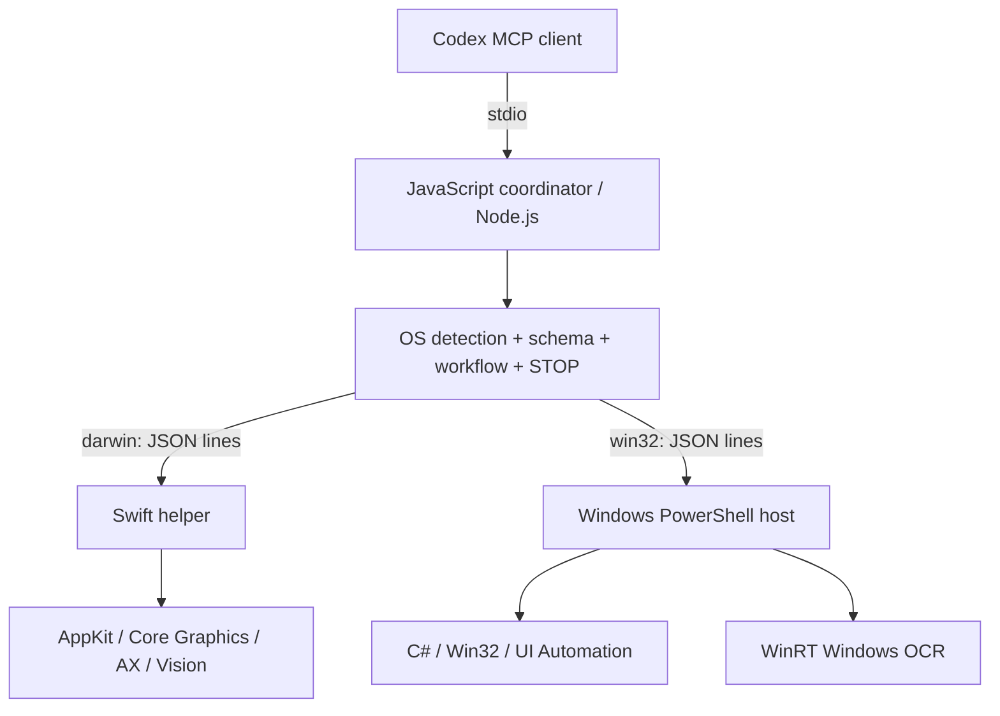

# Architecture / 架构

## JS boundary / JS 边界

`src/platform.js` selects the backend using `process.platform`; scripts do not guess from application names. `src/server.js` exposes three tools through the official MCP JavaScript SDK. `schema.js` validates action shapes before starting native work, and geometry is checked before application activation/input. `controller.js` owns views, a single-call mutex, expected foreground identity, action results, STOP and workflow deadlines. `bridge.js` owns one persistent native process, request IDs, response-size limits and process termination.

JS 使用 `process.platform` 选择后端。动作结构与键名先整批校验，屏幕几何在激活和输入前检查。主控只允许一个桌面请求，其他并发请求明确拒绝。所有原生调用受剩余硬期限约束。

## Native boundary / 原生边界

Requests are single JSON lines: `{id, op, ...parameters}`. Replies are `{id, ok, result}` or `{id, ok:false, error}`. Operations are `status`, `focus`, `guard`, `observe`, `text` and `action`. The native helper has no independent network server. EOF ends the process; input guards check the parent process and STOP marker.

Swift uses `defer` to attempt key/button releases, targets keyboard input to the original foreground PID and routes mouse/scroll events through the session event tap and checks Accessibility, screen session and pointer corner. Screen capture selects ScreenCaptureKit where the SDK/system support it, dynamically resolved Core Graphics memory capture on older systems, or the command fallback. JPEG thumbnails resize once. Bounded AX readiness polling and batched attribute reads avoid unnecessary OCR. Observed control IDs allow native invoke/value/focus actions, with no retry on ambiguous completion.

C# uses DPI-aware Win32 input/capture and bounded UI Automation traversal with cached properties to reduce cross-process calls. UIA InvokePattern/ValuePattern and focus implement semantic control actions. PowerShell compiles it once per worker start, keeps the process alive and supplies WinRT OCR adaptation. No additional .NET SDK is downloaded. `SendInput` return values are checked, but UIPI does not reliably identify its own blocking reason. Windows secure/locked desktop detection uses the current input desktop, while separate monitor sleep detection is not implemented.

原生层在每段文字、每次按键和拖动分段前再次检查急停和前台。正常异常尝试释放输入；强制终止进程无法保证释放。不会自动提权、解锁、清除 STOP 或重放。

## Compatibility / 兼容

The MCP names `desktop_step`, `desktop_status` and `desktop_screenshot` remain. Legacy individual tools are removed from the v1 palette. The plugin identifier remains `codex-computer-control`, and the current JS release is 1.1.0. Python source and the old Python venv are not used by v1; installer backups are retained outside the release tree.

macOS uses logical screen coordinates and Windows uses DPI-aware physical pixels. Screenshot metadata explicitly carries screen/image sizes, crop origin and foreground identity. Views are not transferable between machines, operating systems or restarted workers. Same-process layout changes still require fresh observation.

## Extending / 扩展

Add an OS-specific command in `backendCommand`, implement the same native operations, report capabilities truthfully and add transport/schema/native CI checks. Shared workflow policy belongs in JS. Use another language only when it provides a concrete platform capability; do not spawn Python/Swift/PowerShell per mouse click.

新增平台遵守同一协议，并通过统一 JS 校验和急停机制。语言分工按系统能力选择，不为了使用更多语言而增加进程。

Official API references / 官方接口：

- [MCP JavaScript SDK](https://ts.sdk.modelcontextprotocol.io/server)
- [Apple Core Graphics](https://developer.apple.com/documentation/coregraphics)
- [Apple Vision](https://developer.apple.com/documentation/vision)
- [Windows SendInput and UIPI](https://learn.microsoft.com/windows/win32/api/winuser/nf-winuser-sendinput)
- [Windows UI Automation](https://learn.microsoft.com/en-us/dotnet/api/system.windows.automation.automationelement)
